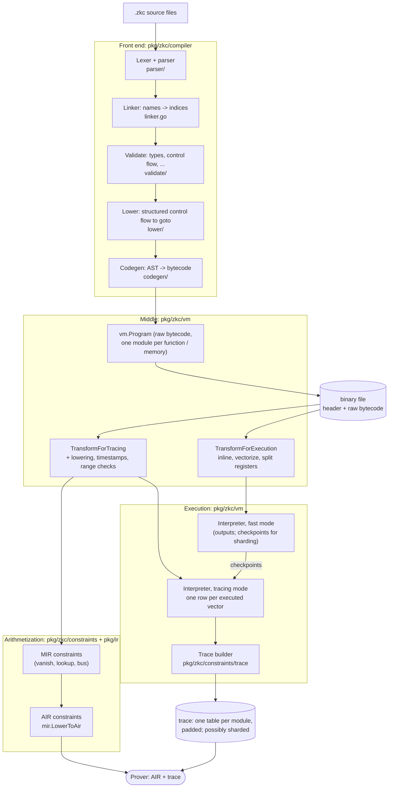

# ZkC Architecture

ZkC follows a relatively standard compiler organisation with a
_front-end layer_, an _intermediate representation layer_ and,
finally, a _backend layer_:

- **[Front End](ZKC_ARCHITECTURE_AST.md)** — parses ZkC source files,
  links cross-file references, type-checks, validates control flow, and
  emits a fully resolved Abstract Syntax Tree (AST).

- **[Intermediate Representation](ZKC_ARCHITECTURE_IR.md)** — lowers the
  AST into a simple register-machine IR, vectorizes the flat instruction
  stream into VLIW-style bundles, and optionally splits wide registers to
  fit within the target field's bandwidth.

- **[Arithmetization Layer](ZKC_ARCHITECTURE_AIR.md)** — compiles the
  vectorized IR into vanishing constraints, range constraints, and lookup
  arguments that form the final arithmetized circuit.

- **[Execution and Tracing](ZKC_ARCHITECTURE_VM.md)** — runs the
  bytecode in an interpreter, records each step as a trace row, and
  optionally cuts long runs into shards.

