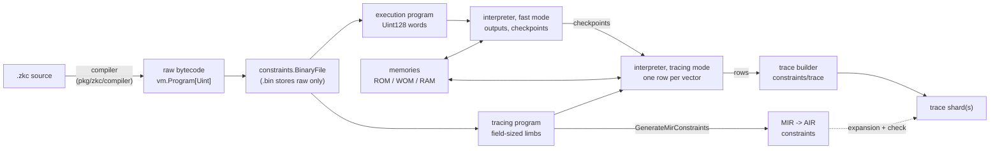

# ZkC Architecture: Execution and Tracing

A ZkC program is compiled once, into _bytecode_, and that one artifact
is used twice:

- the **virtual machine** (`pkg/zkc/vm`) _runs_ the bytecode and
  records every step as a row of a table, called the **trace**;
- the **constraint generator** (`pkg/zkc/constraints`) _reads_ the same
  bytecode and emits the polynomial equations, called the
  **constraints**, which any honest trace satisfies.

A prover then shows that the trace satisfies the constraints. Since
both are derived from the same bytecode, they agree by construction.
The interpreter is not trusted: it only _proposes_ a trace, and the
constraints decide whether that trace is a valid execution.

```text
       bytecode                    bytecode + input
          |                               |
          | constraint generation         | run (interpreter)
          v                               v
     constraints                        trace
     (the rules)                      (the data)
          |                               |
          +---------------+---------------+
                          v
          check: does the trace obey the rules?
          (zkc trace -c, or a real prover)
```

The constraints change only when the program changes; the trace
changes with every input.

## Overview



`constraints.BinaryFile` (`pkg/zkc/constraints/binary_file.go`) is the
entry point for every command. On disk (`zkc compile -o x.bin`) it
holds a header and **only the raw program**. Everything else is
derived on demand and cached:

| Method               | Derived from                                 | Used by                   |
| -------------------- | -------------------------------------------- | ------------------------- |
| `ExecutionProgram()` | `vm.TransformForExecution` (`Uint128` words) | `zkc execute`, sharding   |
| `TracingProgram()`   | `vm.TransformForTracing` (word `W`)          | tracing, constraints      |
| `MirConstraints()`   | `GenerateMirConstraints(TracingProgram())`   | `zkc compile --mir`       |
| `AirConstraints()`   | `GenerateAirConstraints(TracingProgram())`   | trace expansion, checking |
| `Execute(input)`     | execution program                            | `zkc execute`             |
| `Trace(input, cfg)`  | `vm.NewTraceBuilder(...).BootAndTrace`       | `zkc trace`               |
| `Check(cfg, trace)`  | AIR constraints                              | `zkc trace -c`            |

## Running example

The rest of this page follows `testdata/zkc/util/sharding_02.zkc`:

```zkc
input data(addr:u16) -> (b:u8)

fn main() {
    var n:u16 = data[0]::data[1]
    checkNonZero!(n)
}

#[global]
fn checkNonZero(n:u16) -> ! {
    if n == 0 {
        done
    } else if data[n + 1] == 0 {
        fail
    }
    //
    checkNonZero!(n - 1)
}
```

It reads a count `n` from the first two input bytes, then checks that
each of the next `n` bytes is non-zero. `-> !` declares that
`checkNonZero` never returns, and `checkNonZero!(...)` is a call that
never comes back (a tail call). `#[global]` matters for sharding (see
below). With the input `{"data": "0x000266a1"}` the program runs
`main`, then `checkNonZero` with `n = 2, 1, 0`, and stops at `done`.

## The program is data

The compiler produces a `vm.Program`: a list of **modules**, each
either a _function_ or a _memory_. Each module gets its own table in
the trace and its own constraints.

A function has typed **registers** (inputs, outputs, then locals named
`$1`, `$2`, ...) and a body made of **vectors**. A vector is a bundle
of instructions that executes as **one row** of the trace (see
[Vectorization](ZKC_ARCHITECTURE_IR.md#vectorization)). The raw
bytecode (`zkc compile --raw`) for `checkNonZero` is:

```text
 [00]  skip_if n != 0x0 1
       jmp 0x1
       jmp 0x2
 [01]  done
 [02]  add $2 = n+0x1
       read $1 = data[$2]
       skip_if $1 != 0x0 1
       jmp 0x3
       jmp 0x4
 [03]  fail ""
 [04]  sub $3 = n-0x1
       call! checkNonZero($3)
```

`jmp` moves between vectors, whilst `skip_if c k` skips the next `k`
instructions _within_ a vector when `c` holds.

## Two programs from one bytecode

The raw program is transformed twice (`pkg/zkc/vm/transform.go`):

|                    | `TransformForExecution`               | `TransformForTracing`                                                                                                                                         |
| ------------------ | ------------------------------------- | ------------------------------------------------------------------------------------------------------------------------------------------------------------- |
| Purpose            | compute the outputs, fast             | produce rows the constraints can check                                                                                                                        |
| Registers split to | the Go word (`Uint128`: 64-bit limbs) | the field's register width (`KOALABEAR_16`: 16 bits)                                                                                                          |
| Passes             | inline, vectorize, split, allocate    | the same, plus lowering of division, comparisons, bitwise and `switch`, timestamps for RAM, skip-condition factoring, lookup flattening and range constraints |

Every extra tracing pass exists so the program can be checked by
low-degree equations modulo a prime: values must fit the field (see
[Register splitting](ZKC_ARCHITECTURE_IR.md#register-splitting)), only
`+` and `*` are available, and degrees must stay small. For
`checkNonZero`, both pipelines merge the five vectors into one, so
each call is one row. Only the tracing program names each branch test
as a 1-bit register (`fsc$4` for `n != 0`, `fsc$5` for `$1 != 0`):

```text
zkc compile --fast           zkc compile (tracing)
 [00] skip_if n != 0 1        [00] skip_if n != 0 2
      done                         ldc fsc$4 = 0x0
      add $2 = n+0x1               skip 1
      read $1 = data[$2]           ldc fsc$4 = 0x1
      skip_if $1 != 0 1            skip_if fsc$4 != 0 1
      fail ""                      done
      sub $3 = n-0x1               add $2 = n+0x1
      call! checkNonZero($3)       read $1 = data[$2]
                                   skip_if $1 != 0 2
                                   ldc fsc$5 = 0x0
                                   skip 1
                                   ldc fsc$5 = 0x1
                                   skip_if fsc$5 != 0 1
                                   fail ""
                                   sub $3 = n-0x1
                                   call! checkNonZero($3)
```

The tracing pipeline also adds the static tables `$range_u8` and
`$range_u16`, used for range checks.

## The interpreter

The interpreter (`pkg/zkc/vm/internal/interpreter`) runs either
program. `CompileProgram` first flattens it into a single `[]uint32`
of encoded instructions. Along the way it inserts run-time width
checks (`InsertCheckCasts`), which is why they do not appear in
`zkc compile` listings, and it sets **breakpoint** bits.
`Interpreter.Execute` then loops:

```text
1. read the instruction at pc
2. if its breakpoint bit is set, call the breakpoint callback
   (the callback may stop the loop)
3. decode and execute it, updating registers and memories
4. move pc on (next instruction, jump or call target)
```

A normal call pushes a new frame and a return address; `ret` pops
them. A tail call (`call!`) _replaces_ the current frame and pushes
nothing, so a self-recursive `-> !` function runs in constant stack.
The loop stops at `done`, at `ret` from the outermost frame, or on a
failure.

**Breakpoints.** A breakpoint is one bit in an instruction's opcode
(`encoding.BREAKPOINT`), meaning "call the callback just before
running this". It stores nothing. ZkC uses breakpoints in two ways:

| Use                  | Where the bit is set                                                         | What the callback does                                 |
| -------------------- | ---------------------------------------------------------------------------- | ------------------------------------------------------ |
| recording trace rows | every vector terminator: `jmp`, `ret`/`done`, tail call (`isVectorTerminal`) | records the current frame as a row, continues          |
| sharding             | the entry of the shard function (`Program.BreakPoint`)                       | counts entries; takes a checkpoint, or stops the shard |

Exactly one terminator runs on any path through a vector, so the
first use records exactly one row per executed vector. `fail` is not a
terminator: every recognised failure (`fail`, overflow, a failed width
check) goes through `Interpreter.failure`, which fires the callback
before returning the error. The failing row is therefore still
recorded, and the constraints are expected to reject it.

## Memories

Every memory is also a module, i.e. a table indexed by address (see
[Memory](ZKC_LANGUAGE.md#memory) for the language view):

| Declaration    | Runtime type                         | Trace                               |
| -------------- | ------------------------------------ | ----------------------------------- |
| `static`       | `StaticReadOnly`                     | fixed contents, part of the program |
| `input`        | `ReadOnly`                           | final contents, one row per address |
| `output`       | `WriteOnce`                          | final contents, one row per address |
| `memory` (RAM) | `RandomAccess` / `PagedRandomAccess` | one row per access, with timestamps |

In tracing mode, `WithAccessLog` records every RAM access (address,
values read and written, timestamps). Input and output memories need
no log, since their final contents suffice.

## From run to trace

`vm.BootAndTrace` (`pkg/zkc/vm/machine.go`) runs the tracing program
and feeds a `Tracer` (`pkg/zkc/constraints/trace.Builder`):

1. `TraceFunctionLine` appends one row per breakpoint to the table of
   the running function: its registers plus `$ret`, which is `1` on
   the row where the call ends (`ret`, `done` or a tail call).
   Functions with several vectors also get `$pc` and one selector
   column `$is_pc_k` per vector.
1. `TraceMemory` adds one table per memory after the run.
1. `ir.TraceBuilder.BuildShard` then **pads** every table to a power of
   two with zero rows, and **expands** it: columns which the
   constraints need but the run never computed (e.g. inverses, lookup
   selectors) are filled in.

For the running example (`zkc trace --print`), `checkNonZero` has one
row per call. Row `#0` is padding (3 calls, rounded up to 4), and the
last two columns come from expansion:

```text
checkNonZero:
                       |  #0 |         #1 |         #2 |  #3 |
                     n | 0x0 |        0x2 |        0x1 | 0x0 |
                    $1 | 0x0 |       0xa1 |       0x66 | 0x0 |
                    $2 | 0x0 |        0x3 |        0x2 | 0x0 |
                    $3 | 0x0 |        0x1 |        0x0 | 0x0 |
                 fsc$4 | 0x0 |        0x1 |        0x1 | 0x0 |
                 fsc$5 | 0x0 |        0x1 |        0x1 | 0x0 |
                  $ret | 0x0 |        0x1 |        0x1 | 0x1 |
         $lookup_sel_7 | 0x0 |        0x1 |        0x1 | 0x0 |
  (inv checkNonZero:n) | 0x0 | 0x3f800001 |        0x1 | 0x0 |
 (inv checkNonZero:$1) | 0x0 | 0x1df9a3c7 | 0x3d028283 | 0x0 |
```

`n != 0` is not a polynomial, so it is checked as `n * inv = 1` with
`inv` supplied in an extra column. On row `#1`, `2 * 0x3f800001` is `1`
modulo the KoalaBear prime `0x7f000001`.

## From program to constraints

`GenerateMirConstraints` (`pkg/zkc/constraints/translator.go`) walks
the tracing program, with no input, and emits one MIR module per
module of the program. Each kind of constraint answers one question
about the trace (details in the
[Arithmetization Layer](ZKC_ARCHITECTURE_AIR.md)):

| Question                                    | Constraint                                                                                |
| ------------------------------------------- | ----------------------------------------------------------------------------------------- |
| Did each row execute its vector correctly?  | one vanishing constraint per vector, guarded by the path taken through it                 |
| Does each value fit its declared width?     | a lookup into `$range_uN` per register; `r*r = r` for 1-bit registers (`range_lookup.go`) |
| Did each memory read return memory's value? | a lookup from (address, value) into the memory's table                                    |
| Did each call pass the right arguments?     | a lookup into the callee's table, or a **bus** for `#[global]` callees                    |

For `checkNonZero`, the main constraint (`zkc compile --mir`,
condensed and annotated) is:

```text
(vanish checkNonZero:inst
   (if (!= $ret 0)                      ; skip padding rows
      (∧
         (if (== n 0) (== fsc$4 0))     ; fsc$4 = (n != 0)
         (if (!= n 0) (== fsc$4 1))
         (if (!= fsc$4 0)
            (== $2 (+ n 1)))            ; $2 = n + 1
         (if (∧ (== $1 0) (!= fsc$4 0))
            (== fsc$5 0))               ; fsc$5 = ($1 != 0)
         (if (∧ (!= $1 0) (!= fsc$4 0))
            (== fsc$5 1))
         (∨ (!= fsc$5 0) (== fsc$4 0))  ; the fail path
         (if (!= fsc$4 0)
            (== $3 (+ n 2130706432))))))  ; $3 = n - 1 (mod p)
```

An instruction behind a `skip_if` only binds on rows that took its
path, and `fail` becomes a condition that cannot hold once its path is
taken. The calls into `checkNonZero` (from `main`, and from itself)
are checked by a bus, which balances sends and receives across all
tables (and shards):

```text
(bus "bus_checkNonZero"
   ((main:$ret main:n) (checkNonZero:$lookup_sel_7 checkNonZero:$3))
   ((checkNonZero:$ret checkNonZero:n)))
```

`GenerateAirConstraints` then lowers MIR to AIR with `mir.LowerToAir`,
turning `if`, `∧`, `∨` and `!=` into plain polynomials (adding helper
columns such as the inverses above). The register splitting has
already been done by the tracing pipeline, so `mir.Concretize` is not
used.

## Sharding

The field limits a trace in two directions: its bandwidth bounds the
bits per cell (hence register splitting), and its 2-adicity (the
largest `k` such that `2^k` divides `p - 1`) bounds the rows per table. A single trace must also be held in memory and built
at once. Sharding cuts one run into
several **shards**, each a complete trace which can be checked (and
traced, in parallel) on its own:

```text
zkc trace --sharding fn:n input.json prog.zkc

 PASS 1: fast run (execution program)
   breakpoint at the entry of fn
   every n-th entry -> take a CHECKPOINT (plus one at main)
       |
       v
 checkpoints A, B, C, ...
       |
       v
 PASS 2: one job per checkpoint (tracing program)
   restore checkpoint -> run -> record one row per vector
   stop after n more entries of fn
   pad + expand
       |
       v
 shard 0, shard 1, shard 2, ...  (bus balances across all)
```

A **breakpoint** marks _when_ to act; a **checkpoint**
(`Interpreter.CheckPoint`) is _what_ is saved: the function being
entered, its arguments (as bytes, since the two programs lay out
registers differently) and every non-static memory. It saves no call
stack. Pass 1 is `vm.BootAndCheckpoint`; pass 2 is `traceCheckPoints`
(`pkg/zkc/vm/trace_builder.go`), calling `vm.RestoreAndTraceFor` once
per checkpoint.

For the running example, `--sharding checkNonZero:2` gives two
shards: shard 0 holds the rows for `main` and `checkNonZero(2)`, and
shard 1 those for `checkNonZero(1)` and `checkNonZero(0)`. Every shard
repeats the full `data` table and pads every module, so sharding
pays off only when the shard function runs many times.

**Why the shard function must be `#[global] fn ... -> !`.**

- **`-> !`**: a checkpoint has no call stack, so a restored shard has
  nothing to return to. Since the shard function never returns, its
  callers' frames are never needed again. Ordinary calls _inside_ it
  are fine.
- **`#[global]`**: the call that enters a shard is made in the
  previous shard. A lookup only searches within one shard, so such a
  call must be checked by a bus instead. For the same reason the
  compiler rejects a `#[global]` function that returns
  (`validate.GlobalFunctions`): its results could not be passed back
  to a caller in another shard.

`--sharding` does not check that the function is `#[global]`; with a
non-global function the call lookups fail at `zkc trace -c`.

## Limitations

- The RAM constraints (`translate_ram.go`) do not yet enforce that a
  read returns the latest write; cross-row consistency is tracked in
  issue #2160.
- A checkpoint copies every non-static memory, so memory use grows
  with the number of shards.
